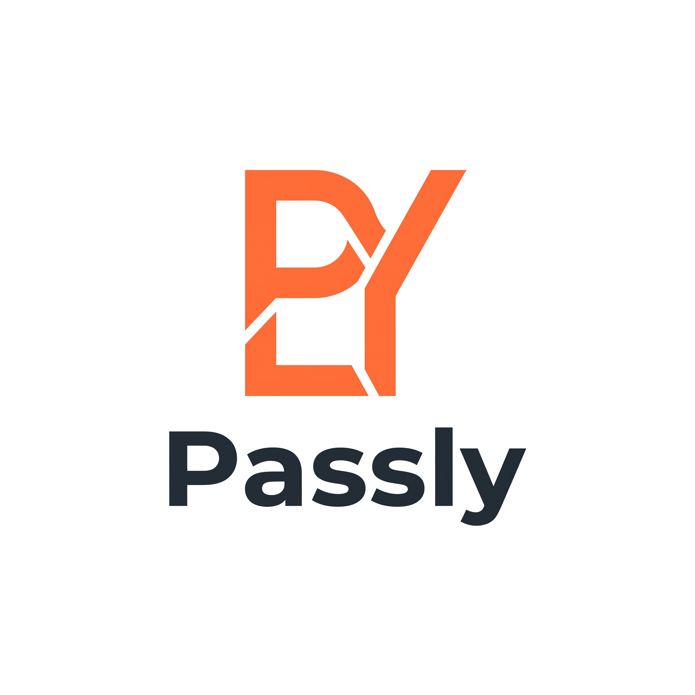

# Passly

<p align="center">  </p>

[](https://adoptium.net/)
[](https://spring.io/projects/spring-boot)
[](./LICENSE)
[](./ROADMAP.md)

An open-source, self-hosted OAuth2/OIDC Authorization Server with social login (Google/GitHub) support — built with Spring Authorization Server.

> **Status:** 🚧 In development. Design phase complete; `auth-server` core implementation in progress. See [Roadmap](./ROADMAP.md) for current status.

## Why Passly

Most backend developers only ever integrate an OAuth2 **client** (e.g. "Sign in with Google" in their own app). Passly is the other side of that relationship — a real Authorization Server you run yourself, so you own the full Authorization Code + PKCE flow instead of delegating it entirely to a third party like Auth0 or Clerk.

## Architecture


Full design decisions and rationale: [`docs/adr/ADR-001-passly-oauth2-auth-server.md`](https://github.com/EagleSoft461/Passly/blob/main/docs/adr/adr-001-oauth2-auth-server.md)

- [Entity Design](https://github.com/EagleSoft461/Passly/blob/main/docs/passly-entity-design.md)
- [API Contract](https://github.com/EagleSoft461/Passly/blob/main/docs/passly-api-contract.md)
- [Roadmap](./ROADMAP.md)
  **Note on OIDC:** v1 implements the OAuth2 Authorization Code + PKCE flow and issues JWT access tokens. Full OpenID Connect (`/.well-known/openid-configuration` discovery, ID Tokens, `/userinfo`, `nonce` validation) is a Future Consideration, not yet implemented — see [`ROADMAP.md`](./ROADMAP.md) for what's in v1 versus deferred.

## Protocol Scope

v1 implements **OAuth 2.x Authorization Server** functionality (Authorization Code + PKCE, JWT access tokens, refresh token rotation). Full **OIDC Provider** features — discovery (`/.well-known/openid-configuration`), ID Tokens, `nonce` validation, `/userinfo` — are deferred to a future phase. See [`ROADMAP.md`](./ROADMAP.md) for the current split.

## OAuth Flow

1. Client redirects the user to Passly's `/oauth2/authorize` with `state` and a PKCE `code_challenge`
2. Passly delegates authentication to Google or GitHub
3. Passly validates the returned `state` and resolves/creates the user (account linking by email)
4. Passly redirects back to the client with a short-lived authorization `code`
5. Client exchanges the `code` + PKCE `code_verifier` at `/oauth2/token`
6. Passly validates the PKCE verifier and issues an access token (JWT, RS256) and a refresh token (opaque, rotating)
7. Client calls the resource server with the access token
8. Resource server validates the token locally using Passly's public key from `/.well-known/jwks.json` — no call back to Passly is needed per request
   See the [sequence diagram](./docs/adr/images/passly-sequence-diagram.svg) in the ADR for the full step-by-step version, including Redis and PostgreSQL interactions.

## Modules

- **`auth-server/`** — the Spring Authorization Server itself: `/oauth2/authorize`, `/oauth2/token`, `/.well-known/jwks.json` (JWKS — the token-signing public keys), `/oauth2/revoke`. Full OIDC discovery (`/.well-known/openid-configuration`) is not yet implemented — see the OIDC note above.
- **`resource-server/`** — an example protected API that validates tokens issued by `auth-server`, purely via JWKS (no calls back to the auth server)
## Tech Stack

- Java 21, Spring Boot 4.0.7
- Spring Authorization Server (Spring Security 7)
- PostgreSQL
- Redis — state / PKCE challenge storage (TTL-based, see ADR-001 Decision 7)
- Docker Compose (self-hosted deployment)
## Key Design Decisions

- **Authorization Code + PKCE only** — no legacy/implicit grant support, PKCE is mandatory for every client, not opt-in
- **RS256 + JWKS** — resource servers validate tokens locally, no per-request call back to the auth server
- **Rotating refresh tokens** — opaque, stored hashed, rotated on every use
- **`state` parameter mandatory** — CSRF protection enforced regardless of client type
  See the full ADR for the reasoning behind each of these.

## Scope

Passly deliberately does not try to be a full Auth0/Okta replacement. See [`ROADMAP.md`](./ROADMAP.md) for what's in v1, what's explicitly out of scope (with reasoning), and what's a genuine future consideration.

## Getting Started

> This section will be finalized once `docker-compose.yml` and `.env` wiring are complete (see [`ROADMAP.md`](./ROADMAP.md) Phase 4). Expected shape:

```bash
git clone https://github.com/EagleSoft461/passly.git
cd passly
cp .env.example .env
# fill in your own Google/GitHub OAuth credentials in .env
docker compose up --build
```

| Service | URL |
|---|---|
| auth-server | http://localhost:9000 |
| resource-server | http://localhost:8080 |

## License

MIT — see [`LICENSE`](./LICENSE).
