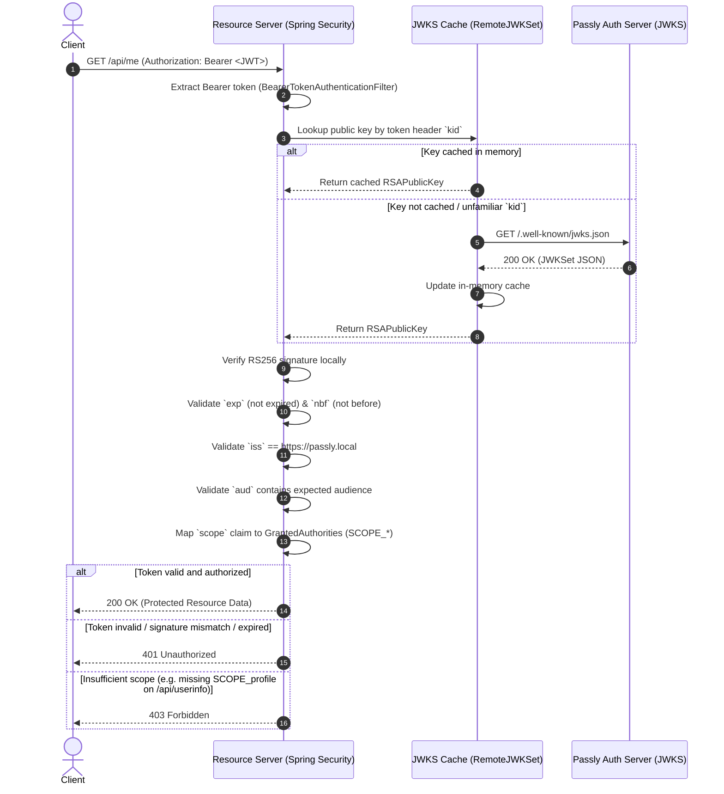

# Passly — Token Validation Architecture (Resource Server)

## 1. Overview & Trust Model

Passly decouples the Authorization Server (`auth-server`) from the Resource Server (`resource-server`) using an asymmetric cryptographic trust model:

```
+-------------------------------------------------------------+
|                Passly Authorization Server                  |
|                                                             |
|  - Holds private RSA key (never exposed)                    |
|  - Signs JWT access tokens (RS256)                          |
|  - Exposes public keys via GET /.well-known/jwks.json       |
+-------------------------------------------------------------+
                               |
                               | Public Key Set (JWKS)
                               v
+-------------------------------------------------------------+
|                   Passly Resource Server                    |
|                                                             |
|  - Configured with jwk-set-uri                              |
|  - Caches public keys in memory                             |
|  - Validates JWT signature & claims locally                 |
|  - No per-request callback or introspection to Auth Server  |
+-------------------------------------------------------------+
```

### Trust Guarantees
1. **Asymmetric Cryptography (RS256):** The Authorization Server signs tokens using a private RSA key (`FileSystemSigningKeyStore`). The Resource Server only requires the corresponding public key to verify signatures.
2. **No Shared Secrets:** Unlike symmetric algorithms (e.g., HS256), the Resource Server never possesses the private signing key, eliminating the risk of key compromise on the resource server.
3. **Public Key Distribution:** Public keys are published in standard JSON Web Key Set (JWKS) format per RFC 7517 at `/.well-known/jwks.json`.
4. **Local Verification:** All signature verification and claim checks happen entirely in memory on the Resource Server without network round-trips to Passly.

---

## 2. Request Validation Flow

When a client presents a Bearer token to a protected endpoint:



---

## 3. Zero Per-Request Callback (Stateless Validation)

Per ADR-001 (NFR2 & Decision 6), Passly rejects token introspection (`POST /oauth2/introspect`) in favor of stateless JWT validation:

- **No Callbacks:** Normal resource requests require zero network calls to Passly Authorization Server.
- **Performance & Decoupling:** The Resource Server validates hundreds or thousands of requests per second with negligible latency, completely decoupled from Authorization Server availability or load.
- **Network Boundary:** Network traffic between Resource Server and Authorization Server is strictly limited to initial JWKS retrieval or key rotation events.

---

## 4. JWKS Discovery vs. Explicit Endpoint Configuration

### Release v0.2.0 Strategy
Passly v0.2.0 uses **explicit JWKS endpoint configuration**:
```yaml
spring:
  security:
    oauth2:
      resourceserver:
        jwt:
          jwk-set-uri: http://localhost:9000/.well-known/jwks.json
```

### Protocol Rationale
- **OIDC Discovery Deferred:** Standard OpenID Connect discovery (`/.well-known/openid-configuration`) and RFC 8414 OAuth 2.0 Authorization Server Metadata are intentionally deferred to future milestones (see `ROADMAP.md` and `ADR-001`).
- **Avoiding Discovery Overhead:** Passly v1 operates as an OAuth 2.x Authorization Server focused on core authorization code flow and JWT access tokens. Spring Security's `issuer-uri` auto-configuration relies on `/.well-known/openid-configuration`, which is not exposed in v0.2.0.
- **Explicit `jwk-set-uri`:** Using `jwk-set-uri` provides standard RFC 7517 compliance without requiring premature implementation of the extensive OpenID Connect metadata specification.

---

## 5. JWKS Caching & Key Rotation

Public key management is handled by Spring Security's integration with Nimbus JOSE+JWT (`RemoteJWKSet` and `DefaultJWKSetCache`):

### Caching Behavior
- **In-Memory Cache:** The retrieved `JWKSet` is cached in memory.
- **Cache Hit:** If the incoming JWT contains a key ID (`kid`) that exists in the local cache, the key is resolved immediately with 0 HTTP requests.
- **Cache Duration:** Nimbus's `DefaultJWKSetCache` maintains keys with a default lifespan of 15 minutes and refresh interval of 5 minutes.

### Key Rotation Handling
When Passly rotates its signing key:
1. Passly publishes the new public key alongside the old key at `/.well-known/jwks.json`.
2. A client sends a token signed with the new key (`kid: "passly-rotated-key"`).
3. The Resource Server looks up `"passly-rotated-key"` in the local cache.
4. Because the `kid` is unfamiliar, `RemoteJWKSet` bypasses the stale cache and triggers an immediate HTTP refresh to `jwk-set-uri`.
5. The updated JWKS containing the new key is cached, and the token is successfully validated.
6. Subsequent requests with the new key reuse the cache.

### Failure Handling
- Signature validation failures for unknown keys that are not present in the refreshed JWKS result in an immediate `JwtException` and `401 Unauthorized`.
- Validation errors are never cached, ensuring security guarantees remain strict.

---

## 6. Token Claims & Validation Rules

The Resource Server enforces the following validation checks via `SecurityConfig.java`:

| Claim / Property | Validation Rule | Failure Result |
|---|---|---|
| **Signature** | Validated against RSA public key from JWKS using RS256 | `401 Unauthorized` |
| **`iss` (Issuer)** | Must match configured `passly.security.jwt.issuer` (`https://passly.local`) | `401 Unauthorized` |
| **`aud` (Audience)** | Must contain configured `passly.security.jwt.audience` (`passly-demo-client`) | `401 Unauthorized` |
| **`exp` (Expiration)** | Must be in the future (validated with default clock skew tolerance) | `401 Unauthorized` |
| **`nbf` (Not Before)** | Must be in the past if present | `401 Unauthorized` |
| **`scope`** | Parsed into `GrantedAuthority` items with `SCOPE_` prefix | Evaluated per endpoint |

---

## 7. Protected Endpoints Specification

### 1. `GET /api/me`
- **Security:** Requires authenticated JWT (`.authenticated()`).
- **Response:**
  ```json
  {
    "subject": "user-123",
    "issuer": "https://passly.local",
    "audience": ["passly-demo-client"],
    "scopes": ["openid", "profile", "email"]
  }
  ```

### 2. `GET /api/userinfo`
- **Security:** Requires `SCOPE_profile` authority (`hasAuthority("SCOPE_profile")`).
- **Response:**
  ```text
  Authenticated user: user-123
  ```
- **Error Codes:**
  - `401 Unauthorized`: Missing, expired, or invalid token.
  - `403 Forbidden`: Valid token, but lacks `profile` scope.
